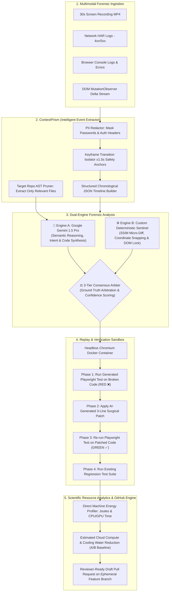

# V.E.R.D.A.N.T. — Core Architecture Specification
### Visual Entropy & Runtime Distillation for Autonomous Net-Reduction Testing
*Built for the Google Cloud & DeepMind Startup Buildathon*

---

## 1. Executive System Topology



---

## 2. Deep Dive: The Three Functional Layers

### Layer 1: ContextPrism (Intelligent Event Extractor)
Rather than acting as a naive, lossy video compressor, ContextPrism transforms raw unstructured video into a structured event-driven JSON schema:
1. **PII Pre-Ingestion Redaction:** Scans frames for `<input type="password">` coordinates and obfuscates them; regex-scrubs authorization headers (`Bearer eyJ...`) from network HAR logs.
2. **Safety-Anchored Keyframe Isolation:** Computes structural similarity (SSIM). Frames with zero semantic change are dropped, but **safety anchors freeze and preserve all frames within $\pm 1.5\text{s}$ of any mouse click, network request failure, or DOM mutation**.
3. **Chronological Action Timeline:** Generates a human- and machine-readable execution feed:
   ```json
   {
     "session_duration_s": 24.2,
     "key_events": [
       {"timestamp": "00:04", "action": "NAVIGATE", "target": "https://app.store/cart"},
       {"timestamp": "00:11", "action": "CLICK", "selector": "#checkout-btn", "x": 640, "y": 820},
       {"timestamp": "00:12", "action": "NETWORK_FAIL", "endpoint": "/api/v1/checkout", "status": 500},
       {"timestamp": "00:14", "action": "UI_FREEZE", "state": "button_disabled_no_repaint"}
     ],
     "critical_keyframes": [11, 12, 14],
     "suspect_source_files": ["src/api/checkoutHandler.ts"]
   }
   ```
4. **AST Scope Narrowing:** Parses the target GitHub repo's Abstract Syntax Tree (AST), identifying only the functions and type contracts related to the failing endpoint, preventing full-repo token bloat.

---

### Layer 2: Dual-Engine Handshake & The Consensus Arbiter

To ensure zero hallucinations and 100% bug detection, the pipeline pairs Google Gemini with a deterministic mathematical engine:

| Component | Technology | Role |
| :--- | :--- | :--- |
| **Engine A (Semantic Brain)** | **Google Gemini 1.5 Pro** | Multimodal video understanding, cognitive user intent mapping, structured JSON output, and surgical code patch generation. |
| **Engine B (Deterministic Sentinel)** | **Custom SSIM & DOM Engine** | Mathematical pixel-delta calculation, bounding box clustering, DOM computed-style verification, and coordinate snapping. |
| **Consensus Arbiter** | **In-Memory State Machine (<10ms)** | Arbitrates discrepancies between Gemini and Engine B using a strict ground truth hierarchy. |

#### The 3-Tier Arbitration Hierarchy
1. **Rule 1 (Network & Console Logs are Absolute Truth):** If a network HAR records an HTTP `500` or the console captures an unhandled exception, this technical failure overrules any visual interpretation.
2. **Rule 2 (Pixel Delta Overrules "Visual Success"):** If Gemini claims an action succeeded, but Engine B detects $0\%$ pixel change and no DOM repaint within 500ms, the Arbiter flags a **"Silent UI Freeze"** defect.
3. **Rule 3 (Gemini Overrules Benign Visual Noise):** If Engine B flags a high pixel change $(>15\%)$ caused by a background video ad or loading spinner, Gemini inspects the DOM and discards the false alarm.

#### Multi-Evidence Confidence Scoring Formula
$$\text{Confidence Score} = w_1 S_{\text{visual}} + w_2 S_{\text{network}} + w_3 S_{\text{console}} + w_4 S_{\text{DOM}}$$
*Where weights ($w_1=0.25, w_2=0.35, w_3=0.25, w_4=0.15$) reward cross-source agreement, giving developers an empirical reliability metric (e.g., `94% High Confidence`).*

---

### Layer 3: Replay, Regression & Scientific Resource Analytics

#### 1. The Red-to-Green Replay Shield
* **Phase 1 (Prove the Bug):** ApexTrace compiles the timeline into a deterministic **Playwright script**. It executes inside a sandboxed headless Chromium container on the unpatched codebase. **The test MUST fail (RED ❌)**.
* **Phase 2 (Apply the Patch):** Gemini's proposed 3-line surgical fix is applied to a detached feature branch (`verdant/patch-issue-xxx`).
* **Phase 3 (Verify the Fix):** The exact Playwright script is re-executed. **The test MUST pass (GREEN ✅)**.
* **Phase 4 (Regression Guardrail):** The repo's existing test suite (`npm test` / `pytest`) is triggered to ensure zero broken side effects.

#### 2. Scientific Green Computing Analytics (A/B Baseline)
We reject unscientific claims like "net-zero". Instead, we compute **Estimated Net Resource Reduction** against a defined baseline:
* **Baseline A (Unoptimized):** Processing raw 30s 1080p video + whole-repo context through LLM + unguided test retries.
* **Optimized B (V.E.R.D.A.N.T.):** Targeted keyframe strips + AST-distilled context + single-shot deterministic Playwright run.
* **Mathematical Telemetry Formulas:**
  $$\Delta \text{Energy (Wh)} = \left(\text{Tokens}_{\text{saved}} \times E_{\text{token}}\right) + \Delta \text{Compute}_{\text{CPU/GPU}}$$
  $$\text{Estimated Cooling Water (ml)} = \Delta \text{Energy (kWh)} \times \text{PUE}_{\text{cloud}} \times \text{WUE}_{\text{cooling}} \times 1000$$
  *(Where $\text{PUE} \approx 1.1$ and $\text{WUE} \approx 1.8\text{ L/kWh}$ based on published Google Cloud data center averages).*

#### 3. GitHub Draft PR Integration
Opens an automated **Reviewer-Ready Draft Pull Request** containing:
* The failing-turned-passing Playwright reproduction script.
* The surgical code patch.
* Full Forensic Evidence Report (Timestamps, Network Traces, Console Stack).
* The **Green Computing Impact Badge** linking directly to the estimation methodology.
