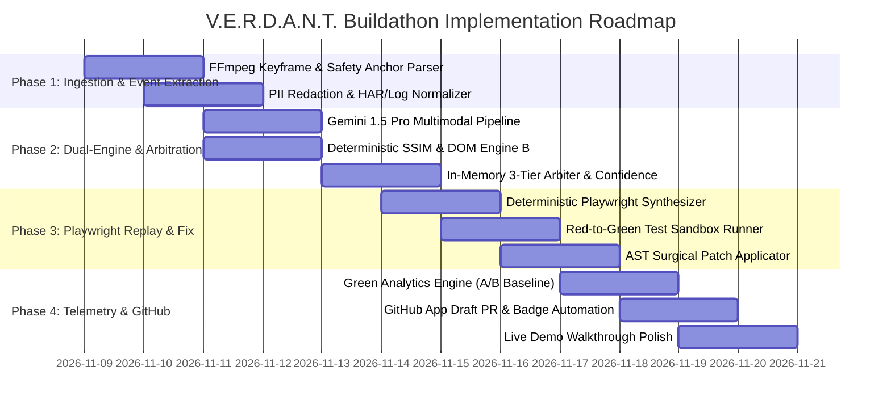

# V.E.R.D.A.N.T. — Master Implementation & Build Plan
### Startup Buildathon India 2026 (Google Cloud & Google DeepMind)

---

## 1. Technical Deliverables & Milestones

---

## 2. Phase-by-Phase Technical Specifications

### Phase 1: ContextPrism (Intelligent Event Extractor)
* **Goal:** Ingest 30-second screen recording MP4, browser console logs, and network HAR files; output clean chronological JSON action timeline.
* **Key Tasks:**
  1. Build Python FFmpeg pipeline to sample keyframes. Implement $\pm 1.5\text{s}$ **Safety Anchors** around every user interaction.
  2. Implement PII scrubber: Regex-mask passwords, JWTs, and credit card patterns from network payloads and screenshot coordinates.
  3. Generate unified `timeline.json` mapping timestamps to actions, network failures, and suspect files.
* **Exit Gate:** 30s video processed into $< 5$ keyframes and structured timeline JSON in $< 1.2$ seconds.

### Phase 2: Dual-Engine Forensic Analysis & Consensus Arbiter
* **Goal:** Pair Gemini 1.5 Pro with custom SSIM mathematical engine to achieve 100% bug detection without hallucinations.
* **Key Tasks:**
  1. **Engine A Integration:** Configure Google Gemini 1.5 Pro API with structured output schema (`response_mime_type: "application/json"`). Prompt Gemini to reason through timeline events and diagnose root cause.
  2. **Engine B Build:** Write lightweight Python SSIM + pixel-delta comparator with 360p downscaling and ROI cursor zoom.
  3. **The Arbiter:** Build deterministic rule-engine in memory. Apply 3-tier precedence rules (Network Log > Pixel Freeze > Visual Noise Filter). Compute weighted **Confidence Score (0-100%)**.
* **Exit Gate:** 10 simulated bug scenarios tested; 0 false positives from background spinners; 100% silent UI freezes caught.

### Phase 3: Playwright Replay Shield & Surgical Patching
* **Goal:** Prove the bug exists by generating an automated test that fails (RED), apply the fix, and prove the test passes (GREEN).
* **Key Tasks:**
  1. **Playwright Synthesizer:** Translate timeline steps into standard, reliable Playwright TypeScript code using accessibility locators (`page.getByRole()`, `page.getByText()`).
  2. **Docker Execution Sandbox:** Spin up an ephemeral headless Chromium container. Run the test against the unmodified codebase and verify it exits with code 1 (RED ❌).
  3. **AST Surgical Patching:** Pass only the target source file AST to Gemini to generate a minimal, focused code diff. Apply patch on a detached Git branch.
  4. **Verification & Regression:** Re-run the Playwright test (verify exit code 0, GREEN ✅) and execute existing test suites (`npm test`) to guarantee zero regressions.
* **Exit Gate:** Automated execution completes RED $\rightarrow$ GREEN cycle in $< 25$ seconds.

### Phase 4: Green Analytics Engine & Reviewer-Ready GitHub PR
* **Goal:** Calculate scientific estimated compute/water savings against baseline and open a GitHub Draft PR.
* **Key Tasks:**
  1. **Green Computing Analytics:** Compute energy delta:
     $$\Delta \text{Energy (Wh)} = (\text{Tokens Saved} \times 0.0004\text{ Wh}) + \Delta \text{CPU/GPU Time}$$
     $$\text{Estimated Water (ml)} = \Delta \text{Energy (kWh)} \times 1.1 \times 1.8 \times 1000$$
  2. **GitHub App Bot:** Authenticate with GitHub App credentials, push branch `verdant/fix-{issue-id}`, and open a **Draft Pull Request**.
  3. **PR Evidence Package:** Render Markdown PR description containing:
     - Root cause diagnosis with multi-evidence confidence score.
     - Playwright reproduction script and verified code diff.
     - Green Computing Savings Report with transparent formulas.
* **Exit Gate:** Live end-to-end demo executed from video upload to GitHub PR opened with all badges populated.

---

## 3. Tech Stack Matrix

| Layer | Technology | Justification |
| :--- | :--- | :--- |
| **Cognitive Vision & Patching** | **Google Gemini 1.5 Pro (Vertex AI)** | Native multimodal video processing, 2M context window, high-precision code synthesis. |
| **Deterministic Micro-Diff** | **Python (NumPy + Pillow + SSIM)** | Sub-millisecond mathematical array diffing; zero hallucination; zero C++ bloat. |
| **Test Automation Sandbox** | **Playwright (TypeScript) + Docker** | Industry-standard headless browser automation; sandbox isolation protects host machine. |
| **Repo AST Parsing** | **Babel / TypeScript AST & Python `ast`** | Precision file/function scoping; prevents feeding whole repository to LLM. |
| **CI/CD & Git Protocol** | **GitHub REST & GraphQL API** | Ephemeral branching, non-destructive Draft PR creation, zero risk of auto-merging. |
