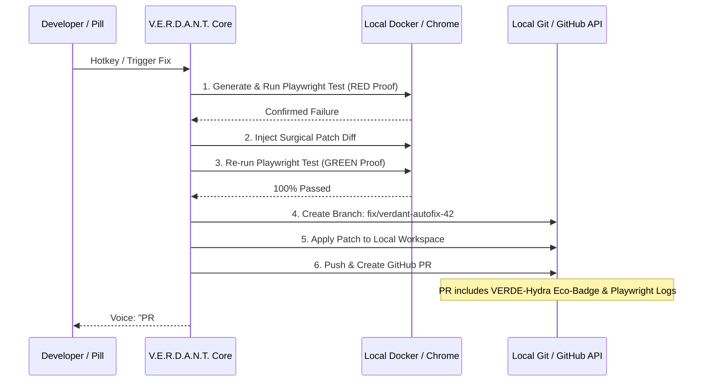

# V.E.R.D.A.N.T. Master Plan: The Universal Video-to-PR & Live Forensic Platform
### *Visual Entropy & Runtime Distillation for Autonomous Net-zero Testing*
**Google Cloud & Google DeepMind — Startup Buildathon India 2026**

---

## 1. Executive Vision: The Dual Ingestion Architecture

V.E.R.D.A.N.T. provides two unified entry points that feed into the exact same multimodal reasoning and GitOps engine:

```
  ┌─────────────────────────────────────────┐     ┌─────────────────────────────────────────┐
  │   CHANNEL 1: DESKTOP FLOATING BAR       │     │    CHANNEL 2: WEB PORTAL / MANUAL DROP  │
  │   (For Developers at their desks)       │     │    (For QA, Product Managers, Users)    │
  │ • Native Floating Capsule (Always-on-top│     │ • Next.js Web App / Dropzone            │
  │ • Global Hotkey ([Alt + Space])         │     │ • Accepts raw MP4 / WebM bug videos     │
  │ • Focused Window Capture (IDE/Terminal) │     │ • Accepts screenshots (PNG/JPG) + HAR   │
  │ • Push-to-Talk Voice Streaming          │     │ • File drag-and-drop onto desktop pill  │
  └────────────────────┬────────────────────┘     └────────────────────┬────────────────────┘
                       │                                               │
                       └───────────────────────┬───────────────────────┘
                                               │
                                               ▼
  ═══════════════════════════════════════════════════════════════════════════════════════════
                                THE V.E.R.D.A.N.T. CORE ENGINE
  ═══════════════════════════════════════════════════════════════════════════════════════════
                                               │
                        ┌──────────────────────┴──────────────────────┐
                        ▼                                             ▼
             [ ContextPrism: AST & PII ]                   [ ApexTrace: SSIM Sentinels ]
             • Distills active code repo                   • 60fps frame-diff extraction
             • Strips 84.9% token bloat                    • Isolates exact glitch keyframes
                        │                                             │
                        └──────────────────────┬──────────────────────┘
                                               │
                                               ▼
                              [ Google Gemini 1.5 Pro & Flash ]
                              • Multimodal Screen + Audio + AST Correlation
                              • Strict JSON Schema Decision Arbiter
                                               │
                                               ▼
  ═══════════════════════════════════════════════════════════════════════════════════════════
                                 THE 5 OPERATIONAL PATHS
  ═══════════════════════════════════════════════════════════════════════════════════════════
```

---

## 2. The 5 Operational Execution Paths

Instead of only offering a code fix, V.E.R.D.A.N.T. intelligently classifies user intent and anomaly type into 5 distinct paths to maintain an ultra-clean, noise-free developer experience:

```
                                  [ Gemini Intent Router ]
                                             │
      ┌──────────────┬───────────────────────┼───────────────────────┬──────────────┐
      ▼              ▼                       ▼                       ▼              ▼
  [ PATH A ]     [ PATH B ]              [ PATH C ]              [ PATH D ]     [ PATH E ]
  Advisory /     Surgical Code Fix       E2E Test Generation     Environment /  Ambiguity /
  Explanation    Detected                (No Bug Present)        Build Error    Follow-Up
```

### **Path A: Advisory / Code Explanation (Voice-Only, Zero Clutter)**
* **When**: Developer asks factual or architectural questions (e.g., *"What is triggering this re-render?"* or *"Explain how this state reducer works"*).
* **Behavior**: 
  * Gemini speaks the diagnosis cleanly in 2–3 sentences.
  * Floating pill pulses softly.
  * **Zero UI clutter**: No diff cards, buttons, or popups appear.

### **Path B: Surgical Code Fix (Closed-Loop GitOps)**
* **When**: A concrete bug or exception is detected in the browser, terminal, or IDE.
* **Behavior**:
  * **Voice**: Speaks a 1-sentence root-cause summary: *"Identified race condition on line 42 where paymentToken is accessed before resolution."*
  * **UI**: A compact, floating diff card slides down from the pill showing the red/green patch.
  * **Action**: `[ Apply Patch & Verify ]` or `[ Dismiss ]`.

### **Path C: E2E Test Generation (Test-Only)**
* **When**: The app is functioning, but developer asks: *"Write a Playwright test reproducing this checkout flow"* or wants to lock down a regression barrier.
* **Behavior**:
  * Synthesizes a new `tests/e2e/checkout.spec.ts` file without altering production application code.
  * Runs the test locally to confirm it passes.
  * Shows 1-click: `[ Commit Test to Branch ]`.

### **Path D: Environment / Build / Dependency Error (1-Click Terminal Action)**
* **When**: The error is environmental (e.g., `EADDRINUSE: port 3000 busy`, missing npm package, broken Docker container, missing `.env` variable).
* **Behavior**:
  * Voice explains the environment conflict.
  * Pill surfaces a 1-click action button: `[ Run: kill -9 $(lsof -t -i:3000) ]` or `[ Run: npm install @stripe/stripe-js ]`.
  * Zero code diffs generated.

### **Path E: Ambiguity & Grounding Follow-up**
* **When**: The screen lacks critical context (e.g., silent logic error without console logs).
* **Behavior**:
  * Rather than hallucinating a guess, Gemini speaks a targeted clarifying question: *"I see the button is disabled, but network logs show no pending request. Is there an active feature flag in your .env?"*

---

## 3. The Universal OS-Level Sentinel: Beyond Browser & IDE

V.E.R.D.A.N.T. lives at the **operating system layer**, perceiving pixels rather than relying on application-specific plugins. Because Google Gemini's multimodal vision processes visual bitmaps natively, it detects anomalies across the developer's entire multi-window desktop:

```
  ┌──────────────────────────────────────────────────────────────────────────────────┐
  │                    THE COMPLETE DEVELOPER DESKTOP WORKSPACE                      │
  │                                                                                  │
  │  [ Postman / Insomnia ]         [ Docker / Kubernetes ]     [ Mobile Emulators ] │
  │  • 401 Unauthorized / JWT       • OOMKilled (Exit 137)      • Android/iOS Crash  │
  │  • 422 Schema Validation        • Port bind conflict        • Flutter Exception  │
  │                                                                                  │
  │  [ Database Clients ]           [ Terminals & Logs ]        [ IDE & Browser ]    │
  │  • DBeaver / TablePlus          • PowerShell, WSL, Bash     • VS Code, Cursor    │
  │  • Missing Column / Migration   • Unhandled Rejection       • CSS / DOM Break    │
  └────────────────────────────────────────┬─────────────────────────────────────────┘
                                           │
                                  [ Alt + Space Hook ]
                                           │
                                           ▼
  ┌──────────────────────────────────────────────────────────────────────────────────┐
  │                  UNIVERSAL VISUAL ANOMALY TO TARGET WORKSPACE                    │
  │  1. Zero App Plugins: Works on any software without third-party extensions       │
  │  2. Cross-App Correlation: Connects external app errors back to codebase files   │
  │  3. Surgical Action: Generates git patches, terminal fixes, or migrations        │
  └──────────────────────────────────────────────────────────────────────────────────┘
```

### **Universal Cross-App Diagnostic Matrix**
| External Application | Visual Anomaly Detected by Gemini | Autonomous Action by V.E.R.D.A.N.T. |
| :--- | :--- | :--- |
| **Postman / Insomnia** | Red `401 Unauthorized` or missing auth header | Surfaces patch for backend auth middleware (`auth.ts`). |
| **Docker Desktop** | Container status `Exited (137) Out of Memory` | Surfaces 1-click patch for `docker-compose.yml` memory limits. |
| **Android / iOS Emulator**| Native crash dialog (*"App has stopped"*) | Pinpoints Kotlin/Swift null reference and patches mobile repo. |
| **DBeaver / TablePlus** | `column "user_role" does not exist in relation` | Surfaces 1-click terminal command: `npx prisma migrate dev`. |
| **System Terminal** | `EADDRINUSE: port 3000 already in use` | Surfaces 1-click terminal button: `kill -9 $(lsof -t -i:3000)`. |

---

## 4. End-to-End GitOps Architecture

Every fix in **Path B** and test in **Path C** is connected directly to GitHub with verifiable proof:



### The GitHub PR Template (Auto-Generated by VERDE-Hydra):
```markdown
## 🌿 V.E.R.D.A.N.T. Autonomous Bug Fix: Issue #42

### 1. Root Cause Summary
Race condition detected at `src/components/Checkout.tsx`: `paymentToken` was dereferenced prior to asynchronous resolution.

### 2. Surgical Patch Diff
```diff
- if (cart.items.length && !isProcessing)
+ if (cart.items.length && !isProcessing && paymentToken)
```

### 3. Closed-Loop Playwright Verification Proof
- [x] **RED Phase**: `tests/reproducers/bug_42.spec.ts` failed on unpatched code.
- [x] **GREEN Phase**: Test passed with 0 errors in 1.4s post-patch.

### 4. ⚡ VERDE-Hydra Eco-Telemetry Audit
- **Energy Saved**: 89.7 Wh (prevented 4 manual CI rebuild cycles)
- **Cooling Water Saved**: 142 mL (Google Cloud PUE 1.10 / WUE 1.58 L/kWh)
- **Token Efficiency**: Distilled by 84.9% via ContextPrism AST
```

---

## 5. Dual Platform Specifications

### **A. Desktop Floating Capsule (`verdant-bar.exe`)**
* **Form Factor**: Draggable, 320x48px frosted glass pill, stays on top of all windows.
* **Hotkey**: Global listener (`Alt + Space`).
* **Active Window Snapper**: Uses Windows `win32gui` / `GetForegroundWindow` to capture strictly the IDE, terminal, or browser window in focus.
* **File Drop Support**: Users can drag a screenshot or video file directly onto the floating pill to trigger instant analysis.

### **B. Web Dashboard (`verdant-web`)**
* **Stack**: Next.js 14, TailwindCSS, Lucide icons.
* **Purpose**: 
  * Allows QA engineers, non-developers, or remote teammates to upload MP4/WebM bug videos.
  * Live status board showing incoming bug reports, AST compression gauges, and dispatched GitHub PRs.
  * Connects to the same backend REST API as the desktop client.

---

## 6. Team Execution Plan

| Module | Dhairya | Teammate |
| :--- | :---: | :---: |
| **Multimodal Gemini Vision & Audio Pipeline** | Primary | |
| **ContextPrism AST Skeletonizer & Intent Router (5 Paths)** | Primary | |
| **VERDE-Hydra Eco-Telemetry & GitHub PR Bot** | Primary | |
| **Desktop Floating Capsule UI & Hotkey Listener** | | Primary |
| **Local Playwright Test Runner & File Patcher** | | Primary |
| **Web Dashboard Dropzone (Next.js / FastAPI)** | | Primary |
